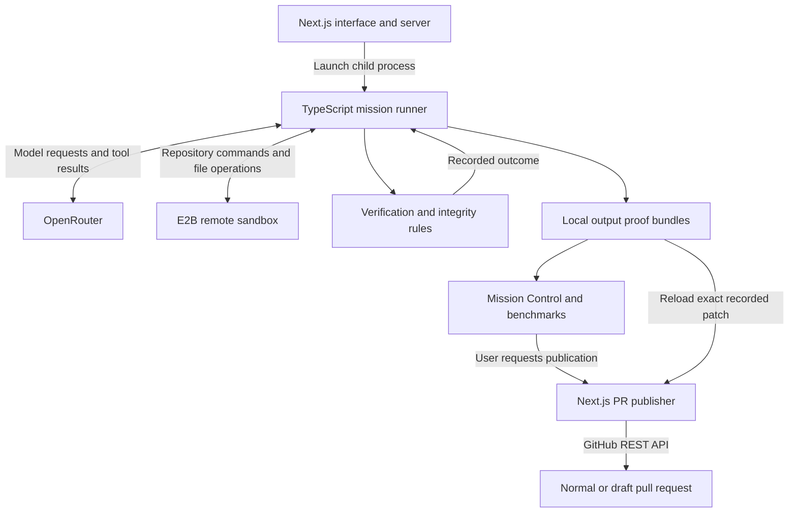

# PatchVerdict

**Every patch earns its verdict.**

PatchVerdict is an AI-assisted repository debugging and repair system built for **Leapfrog Frogtoberfest — Build with AI**. Give it a public GitHub issue or a repository and bug description. It attempts to reproduce the failure, investigates with an external model and repository tools, applies a candidate repair, and records the checks behind its verdict.

Inspect the recorded base commit, investigation report, patch diff, command evidence, and verdict. A human can request a pull request for an eligible repair.

## Why evidence matters

A plausible patch is only the beginning. A failing command might reflect a broken environment rather than the reported bug; a green test suite might follow a change to the tests themselves. Model confidence cannot resolve either problem.

PatchVerdict separates model proposals, observed execution, deterministic checks, and human publication. Its value is making the reasons for accepting, rejecting, or reviewing a candidate visible—not promising that every bug can be repaired.

## Follow a mission

1. **Describe the failure.** Submit a public GitHub issue URL, or switch to a repository URL and manual report. Optional advanced fields specify a reproduction command and expected failure text.
2. **Prepare and reproduce.** The TypeScript CLI clones the repository into an E2B sandbox, installs dependencies, records its base commit, and checks the baseline failure against the configured expectation.
3. **Investigate.** An OpenRouter model can list, read, and search files and request targeted tests. Structured diagnosis and source-reference checks constrain the result; generated explanations remain hypotheses, not proof of correctness.
4. **Apply a candidate.** The patch phase makes text replacements and captures Git evidence. If the post-repair reproduction still fails, the runner permits one correction attempt.
5. **Verify.** The runner checks the reproduction command and the repository's full test command, then combines those results with patch-integrity analysis to determine a verdict.
6. **Inspect and decide.** Saved evidence appears in Mission Control. An eligible `VERIFIED` result can become a normal PR; `REVIEW_REQUIRED` can become a draft. Publication requires a human request and a configured server token.

Execution can stop before these stages finish. A failed mission may have partial evidence and no repair verdict.

## What is implemented

- **AI-assisted investigation and repair:** bounded tool loops, structured diagnosis, source-reference validation, and a candidate correction path.
- **Execution-based evidence:** baseline, post-repair, and full-suite command results from a remote E2B sandbox.
- **Integrity-aware verdicts:** deterministic rules distinguish failed checks from changes that need human inspection.
- **Live and saved Mission Control:** real progress events, a diff viewer, investigation report, verification evidence, and persisted proof bundles.
- **GitHub workflow:** public issue ingestion and separate, user-initiated publication of the recorded patch.
- **Controlled Benchmark Dashboard:** fixed selected runs, evidence-derived totals, and automatically refreshed local mission history.

The controlled examples below demonstrate specific repairs; they do not establish arbitrary-repository reliability.

## Architecture



The web server launches the existing CLI and reads local files. There is no database or job queue. A long-lived Node host, the complete checkout, root dependencies, and writable `output/` storage are required. See [System Design](docs/SYSTEM_DESIGN.md) for process boundaries and failure paths.

## Read the verdict

| Result            | Meaning                                                                                                                                   |
| ----------------- | ----------------------------------------------------------------------------------------------------------------------------------------- |
| `VERIFIED`        | Baseline reproduction, patch application, post-repair reproduction, and full-suite checks passed, with integrity classified as preserved. |
| `REVIEW_REQUIRED` | Those functional checks passed, but verification-related changes triggered an integrity review flag.                                      |
| `FAILED`          | A required functional check failed, or verification integrity was classified as compromised.                                              |
| No verdict        | Execution ended before a final repair decision, or valid verdict evidence is unavailable.                                                 |

Execution status and repair verdict are separate: a mission can finish with a `FAILED` repair verdict. **`VERIFIED` applies only to the checks performed.** Integrity detection uses file and diff heuristics; it is not a proof of universal correctness. [Verification](docs/VERIFICATION.md) explains the exact precedence and limitations.

## Recorded controlled results

Local saved bundles inspected on **2026-10-21** supported:

| Selected scenarios | Valid bundles | VERIFIED | REVIEW_REQUIRED |
| -----------------: | ------------: | -------: | --------------: |
|                  7 |             7 |        6 |               1 |

This is **6/7 selected outcomes (85.7%)**, not a real-world bug-fixing success rate. In the Test State Leak scenario, tests passed but the patch changed `setupTests.js`, triggering human review.

On **2026-10-24**, the catalog expanded to nine selected scenarios while retaining all seven above: six VERIFIED, two REVIEW_REQUIRED, and one completed FAILED verdict (**6/9 = 66.7%**). See the [current selection and negative-control explanation](docs/BENCHMARK_DASHBOARD.md#current-nine-scenario-selection-2026-10-24). The table above remains the earlier dated snapshot.

The dashboard derives its values from available saved proofs. Ignored `output/` artifacts do **not** ship with a GitHub clone, so a fresh checkout will not reproduce this history without the corresponding bundles. See [benchmark identities, methodology, and preservation guidance](docs/BENCHMARK_DASHBOARD.md).

## Run locally

Use **Node.js 24** (the CI target), **pnpm 12.8.1**, and Git. Root and web dependencies are separate installations. The current CI uses non-frozen installs because the committed lockfiles are incomplete.

```sh
git clone https://github.com/prahans/patch-verdict.git
cd patch-verdict
pnpm install --no-frozen-lockfile
cp .env.example .env
cd apps/web
pnpm install --no-frozen-lockfile
```

Set `OPENROUTER_API_KEY` and `E2B_API_KEY` in the root `.env`; optionally override `AGENT_MODEL`. Then, from `apps/web`:

```sh
pnpm dev
```

Open [localhost:3000](http://localhost:3000). Live repair missions require external providers and may incur charges. Public issue lookup needs no GitHub token. Optional PR publication uses `PATCHVERDICT_GITHUB_TOKEN` in the web server environment or `apps/web/.env.local`; never expose it through a `NEXT_PUBLIC_` variable. [Getting Started](docs/GETTING_STARTED.md) covers permissions, inputs, production requirements, and troubleshooting.

## Stack and quality checks

TypeScript, Node.js, Next.js, React, OpenRouter, E2B, GitHub REST, pnpm, Vitest, Node's test runner, ESLint, and GitHub Actions.

```sh
# Repository root
pnpm typecheck
pnpm test

# apps/web
node --test tests/*.test.mjs
pnpm exec next typegen
pnpm exec tsc --noEmit
pnpm lint
pnpm build
```

[CI](.github/workflows/ci.yml) runs these checks in separate backend/frontend jobs on Node 24. Tests use fixtures and mocks; CI does not run paid AI repair missions or measure general repair reliability.

## Scope and AI disclosure

Repository preparation currently expects a root `package.json`, an npm or pnpm lockfile, and a test script. Targeted investigation tests are Vitest-specific. Unreproducible bugs, unsupported projects, provider failures, and timeouts can stop a mission. The app has no built-in user authentication and is intended for a trusted local/demo environment, not arbitrary public multi-tenant use.

AI coding tools assisted project development. At runtime, PatchVerdict calls models through OpenRouter for investigation and candidate patches; code evaluates the final checks. No authorship percentages or independent correctness guarantees are claimed.

## Documentation

| Guide                                                        | Read it to…                                                    |
| ------------------------------------------------------------ | -------------------------------------------------------------- |
| [Getting Started](docs/GETTING_STARTED.md)                   | Install, configure, run, and troubleshoot.                     |
| [System Design](docs/SYSTEM_DESIGN.md)                       | Trace components, data, and execution boundaries.              |
| [Verification](docs/VERIFICATION.md)                         | Inspect reproduction, integrity, verdicts, and proof contents. |
| [GitHub Issue and PR Flow](docs/GITHUB_ISSUE_PR_FLOW.md)     | Understand canonical input and exact-patch publication.        |
| [Benchmark Dashboard](docs/BENCHMARK_DASHBOARD.md)           | Examine selected evidence and its limitations.                 |
| [Security and Limitations](docs/SECURITY_AND_LIMITATIONS.md) | Review implemented controls and remaining risks.               |
| [Demo Guide](docs/DEMO_GUIDE.md)                             | Rehearse the presentation and technical Q&A.                   |
