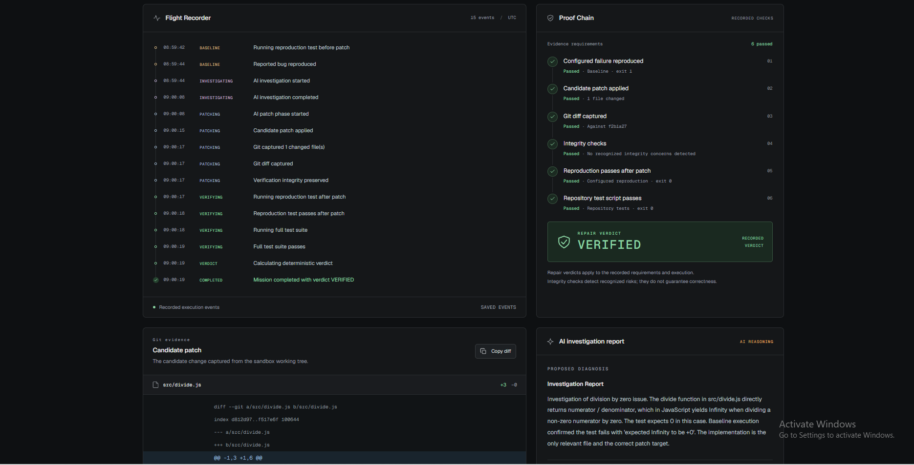
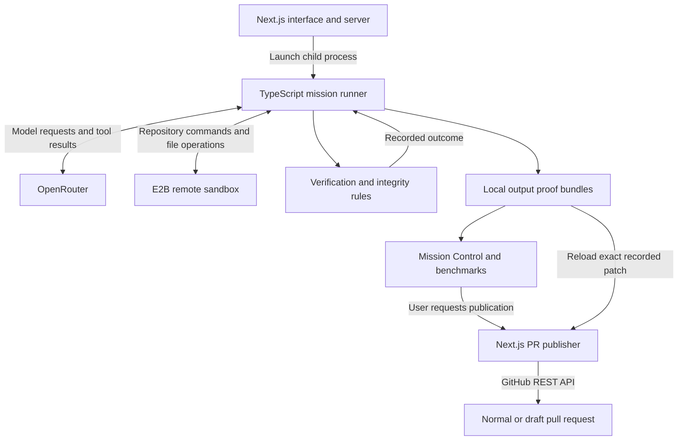
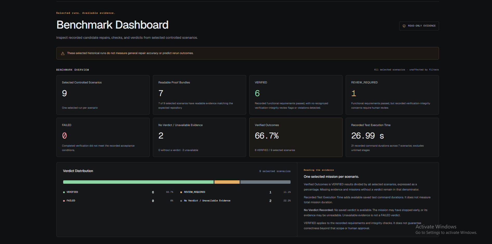

# PatchVerdict

**Candidate repairs. Recorded evidence.**

PatchVerdict is an AI-assisted repository debugging and repair verification system built for **Leapfrog Frogtoberfest 2026 — Build with AI**. It investigates reported bugs, attempts candidate repairs, and evaluates them against configured reproduction, repository-test, and integrity checks.

Mission Control brings together the recorded base commit, AI investigation report, candidate diff, command evidence, and verdict when available, so a person can inspect how the repair was evaluated.

## Demo

**[Live Demo](https://patchverdict.duckdns.org/)** · **[Demo Video](https://youtu.be/escDTfDGirs)**

The public deployment is a **read-only showcase** of controlled benchmarks and available saved mission evidence. Live mission creation and GitHub pull request publication are disabled on the public website. The complete application supports those workflows in a separately configured local interactive instance; the public deployment restrictions do not remove those capabilities.



## Why evidence matters

A plausible patch is only the beginning. A failing command might reflect a broken environment rather than the reported bug; a green test suite might follow a change to the tests themselves. Model confidence cannot resolve either problem.

PatchVerdict separates model proposals, observed execution, deterministic checks, and human publication. Its value is making the reasons for accepting, rejecting, or reviewing a candidate visible—not promising that every bug can be repaired.

## Follow a mission

In a local interactive instance:

1. **Describe the failure.** Submit a public GitHub issue URL, or switch to a repository URL and manual report. Optional advanced fields specify a reproduction command and expected failure text.
2. **Prepare and reproduce.** The TypeScript CLI clones the repository into an E2B sandbox, installs dependencies, records its base commit, and checks the baseline against configured exit-code and output expectations. A match alone does not prove the reported bug caused the failure.
3. **Investigate.** An OpenRouter model can list, read, and search files and request targeted tests. Structured diagnosis and source-reference checks constrain the result; generated explanations remain hypotheses, not proof of correctness.
4. **Apply a candidate.** The patch phase makes text replacements and captures Git evidence. If the post-repair reproduction still fails, the runner permits one correction attempt.
5. **Verify.** The runner reruns the reproduction command and the repository's existing test script, then combines those results with verification-integrity analysis to determine a verdict.
6. **Inspect and decide.** Saved evidence appears in Mission Control. An eligible `VERIFIED` result can become a normal PR; `REVIEW_REQUIRED` can become a draft. Publication requires a separate user request, a configured server token, and repository write access. PatchVerdict does not merge PRs.

Execution can stop before these stages finish. A failed mission may have partial evidence and no repair verdict.

## What is implemented

- **AI-assisted investigation and repair:** bounded tool loops, structured diagnosis, source-reference validation, and a candidate correction path.
- **Execution-based evidence:** baseline, post-repair, and repository test-script results from a remote E2B sandbox.
- **Integrity-aware verdicts:** deterministic rules distinguish failed checks from changes that need human inspection.
- **Live and saved Mission Control:** real progress events, a diff viewer, investigation report, verification evidence, and persisted proof bundles.
- **GitHub workflow:** public issue ingestion and separate, user-initiated publication of the recorded patch.
- **Controlled Benchmark Dashboard:** fixed selected runs, evidence-derived totals, and automatically refreshed local mission history.

The controlled scenarios below record candidate repairs and their outcomes; they do not establish arbitrary-repository reliability.

## Architecture



The web server launches the existing CLI and reads local files. There is no database or job queue. A long-lived Node host, the complete checkout, root dependencies, and writable `output/` storage are required. See [System Design](docs/SYSTEM_DESIGN.md) for process boundaries and failure paths.

## Read the verdict

| Result            | Meaning                                                                                                                                   |
| ----------------- | ----------------------------------------------------------------------------------------------------------------------------------------- |
| `VERIFIED`        | The configured baseline failure matched, a candidate patch was applied, and post-repair reproduction and repository tests passed, with no recognized integrity review flags or violations detected. |
| `REVIEW_REQUIRED` | Those functional checks passed, but recorded verification-integrity concerns require human review. |
| `FAILED`          | A required functional check failed, or verification integrity was classified as compromised.                                              |
| No verdict        | Execution ended before a final repair decision, or valid verdict evidence is unavailable.                                                 |

Execution status and repair verdict are separate: an execution can be `COMPLETED` with a `FAILED` repair verdict, or `FAILED` with no verdict. Unavailable evidence is not itself a failed repair. **`VERIFIED` applies only to the recorded checks**; it does not establish exhaustive coverage, security, or human approval. Integrity detection uses file and diff heuristics. [Verification](docs/VERIFICATION.md) explains the exact precedence and limitations.

## Recorded controlled results

The documented local evidence inspections recorded these two selections:

| Inspection date | Selected scenarios | Valid bundles | VERIFIED | REVIEW_REQUIRED | FAILED | Verified Outcomes |
| --- | ---: | ---: | ---: | ---: | ---: | ---: |
| 2026-10-21 | 7 | 7 | 6 | 1 | 0 | 6/7 = 85.7% |
| 2026-10-24 | 9 | 9 | 6 | 2 | 1 | 6/9 = 66.7% |



*The benchmark screenshot shows seven readable bundles out of nine selected scenarios. The two unavailable entries remain in the denominator; the dated local inspections below describe their own evidence availability.*

The current nine-scenario catalog retains the original seven and adds Subscription Clock Fixture (`REVIEW_REQUIRED`) and Conflicting Contract (`FAILED`). Conflicting Contract is an artificial negative-control fixture: its execution completed, but the candidate failed the configured repository test script. In the Test State Leak scenario, tests passed but the patch changed `setupTests.js`, triggering human review.

These are selected historical outcomes, **not real-world bug-fixing success rates or predictions for reruns**. Verified Outcomes divides VERIFIED records by all selected scenarios, including entries whose evidence is unavailable. See the [current selection and negative-control explanation](docs/BENCHMARK_DASHBOARD.md#current-nine-scenario-selection-2026-10-24).

The dashboard derives its values from available saved proofs. Ignored `output/` artifacts do **not** ship with a GitHub clone, so a fresh checkout will not reproduce this history without the corresponding bundles. See [benchmark identities, methodology, and preservation guidance](docs/BENCHMARK_DASHBOARD.md).

## Run locally

Use **Node.js 24** (the CI target), **pnpm 12.8.1**, and Git. Root and web dependencies are separate installations. The current CI uses non-frozen installs because the committed lockfiles are incomplete.

```sh
git clone https://github.com/prahans/patch-verdict.git
cd patch-verdict
pnpm install --no-frozen-lockfile
cp .env.example .env
cd apps/web
pnpm install --no-frozen-lockfile
```

Set `OPENROUTER_API_KEY` and `E2B_API_KEY` in the root `.env`; optionally override `AGENT_MODEL`. Then, from `apps/web`:

```sh
pnpm dev
```

Open [localhost:3000](http://localhost:3000). Live repair missions require external providers and may incur charges. Public issue lookup needs no GitHub token. Optional PR publication uses `PATCHVERDICT_GITHUB_TOKEN` in the web server environment or `apps/web/.env.local`; never expose it through a `NEXT_PUBLIC_` variable. [Getting Started](docs/GETTING_STARTED.md) covers permissions, inputs, production requirements, and troubleshooting.

## Stack and quality checks

TypeScript, Node.js, Next.js, React, OpenRouter, E2B, GitHub REST, pnpm, Vitest, Node's test runner, ESLint, and GitHub Actions.

```sh
# Repository root
pnpm typecheck
pnpm test

# Frontend (from the repository root)
cd apps/web
node --test tests/*.test.mjs
pnpm exec next typegen
pnpm exec tsc --noEmit
pnpm lint
pnpm build
```

[CI](.github/workflows/ci.yml) runs these checks in separate backend/frontend jobs on Node 24. Tests use fixtures and mocks; CI does not run paid AI repair missions or measure general repair reliability.

## Scope and AI disclosure

The supported workflow targets public JavaScript/TypeScript repositories with a root `package.json`, a matching npm or pnpm lockfile, and a test script. Targeted investigation tests are Vitest-specific. Unreproducible bugs, unsupported projects, provider failures, and timeouts can stop a mission. The interactive application has no built-in user authentication; keep it under trusted operator access. See [Security and Limitations](docs/SECURITY_AND_LIMITATIONS.md) for tool, evidence, and hosting boundaries.

AI coding tools assisted project development. At runtime, PatchVerdict consumes OpenRouter model output programmatically:

- [`src/agent/investigate.ts`](src/agent/investigate.ts): `investigateIssue()` processes model-generated tool requests and parses structured diagnosis output, validating references against observed repository evidence.
- [`src/agent/patch.ts`](src/agent/patch.ts): `patchIssue()` checks requested tools against its patch-phase allowlist, parses model-generated JSON arguments, and invokes [`executeTool()`](src/tools/index.ts) for permitted repository operations.

The [mission runner](src/mission/runner.ts) executes verification commands; programmatic integrity checks and [deterministic verdict rules](src/proof/verdict.ts) determine the recorded repair verdict from execution evidence. AI confidence does not select that verdict, and an AI-generated diagnosis is not independent proof of correctness.

## Documentation

| Guide                                                        | Read it to…                                                    |
| ------------------------------------------------------------ | -------------------------------------------------------------- |
| [Getting Started](docs/GETTING_STARTED.md)                   | Install, configure, run, and troubleshoot.                     |
| [System Design](docs/SYSTEM_DESIGN.md)                       | Trace components, data, and execution boundaries.              |
| [Verification](docs/VERIFICATION.md)                         | Inspect reproduction, integrity, verdicts, and proof contents. |
| [GitHub Issue and PR Flow](docs/GITHUB_ISSUE_PR_FLOW.md)     | Understand canonical input and exact-patch publication.        |
| [Benchmark Dashboard](docs/BENCHMARK_DASHBOARD.md)           | Examine selected evidence and its limitations.                 |
| [Security and Limitations](docs/SECURITY_AND_LIMITATIONS.md) | Review implemented controls and remaining risks.               |
| [Demo Guide](docs/DEMO_GUIDE.md)                             | Rehearse the presentation and technical Q&A.                   |
