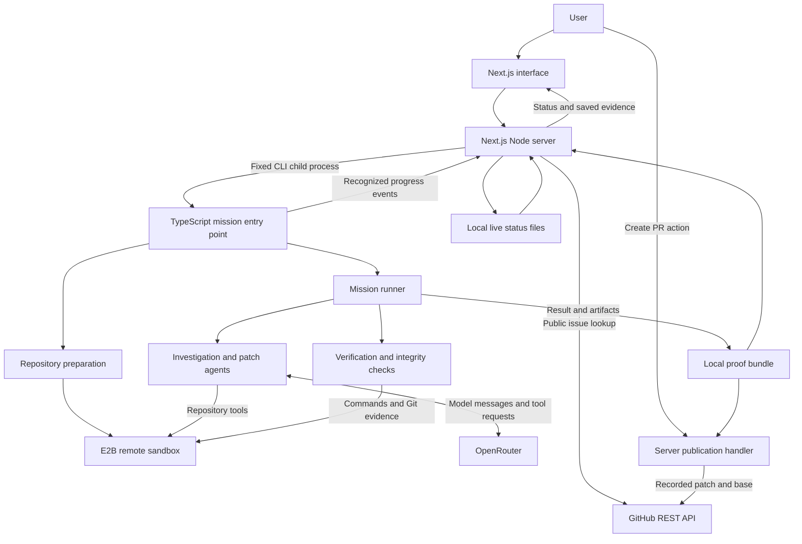

# System design

PatchVerdict coordinates a repository debugging mission from a Next.js server. AI proposes a diagnosis and a candidate edit; sandbox commands produce observations; deterministic code evaluates the recorded checks. The browser presents progress and saved evidence, and a person can separately request an eligible pull request.

This document is for engineers and technical reviewers. See [Getting started](GETTING_STARTED.md) for operation, [Verification](VERIFICATION.md) for the decision rules, and [Security and limitations](SECURITY_AND_LIMITATIONS.md) for trust boundaries.

The architecture below describes the full interactive application for trusted local or private operation. The project's [public demo](https://patchverdict.duckdns.org/) is operated as a read-only showcase, with mission creation and PR publication disabled at the deployment boundary. That deployment restriction does not imply built-in authentication or an application-level demo guard in this branch.

## Runtime architecture

The application has two locally installed packages: the root TypeScript engine and `apps/web`. There is no database, message broker, or durable worker service. The web server starts a real Node child process in the same checkout; the target repository and its commands run remotely in E2B. Local `output/` files connect execution, Mission Control, benchmarks, and publication.

## Component map

| Component | Responsibility | Main sources |
| --- | --- | --- |
| Input and issue resolution | Validate manual input or fetch canonical public issue context | [mission-input.ts](../apps/web/lib/mission-input.ts), [github-issue.ts](../apps/web/lib/github-issue.ts) |
| Web-to-engine bridge | Start the fixed CLI, track events, enforce the web mission deadline | [run-backend-mission.ts](../apps/web/lib/run-backend-mission.ts) |
| Mission entry point | Create the sandbox, prepare the repository, build the verification plan, save the result, clean up | [real-mission-demo.ts](../src/real-mission-demo.ts) |
| Repository preparation | Clone, identify package manager/test command, install dependencies, check initial Git state | [repository/](../src/repository/) |
| Mission orchestration | Baseline, investigation, patch, optional correction, verification, verdict | [runner.ts](../src/mission/runner.ts) |
| AI integration | OpenRouter messages, bounded tool interaction, diagnosis validation, candidate edits | [agent/](../src/agent/), [openrouter.ts](../src/ai/openrouter.ts) |
| Execution and tools | E2B commands, file inspection/replacement, targeted tests, Git evidence | [e2b.ts](../src/sandbox/e2b.ts), [tools/](../src/tools/) |
| Verification | Reproduction classification, diff integrity analysis, deterministic verdict | [verification/](../src/verification/), [verdict.ts](../src/proof/verdict.ts) |
| Saved evidence | Write a version 2 bundle; validate and project it for the UI | [bundle.ts](../src/proof/bundle.ts), [load-proof-bundle.ts](../apps/web/lib/load-proof-bundle.ts) |
| Optional publication | Validate an eligible saved patch and publish through GitHub REST | [github-pull-request.ts](../apps/web/lib/github-pull-request.ts), [exact-verified-patch.ts](../apps/web/lib/exact-verified-patch.ts) |

## 1. Submission and server boundaries

The landing page accepts a public GitHub issue URL or a repository URL with a manual bug description. Both modes allow an optional reproduction command and failure marker. Issue preview is a convenience: submission fetches the issue again on the server, derives its repository and title/body, and passes that canonical context into the repository-oriented engine. No GitHub write token is needed for public issue reads or verification.

[`POST /api/missions`](../apps/web/app/api/missions/route.ts) validates bounded JSON input, creates a server-generated `web-<UUID>` mission ID, saves initial status, and returns HTTP 202 with mission and status URLs. It does not wait for the repair. Next.js `after()` tracks the child completion promise.

The bridge launches `process.execPath`, the root-installed `tsx` entry point, and `src/real-mission-demo.ts` with separate arguments and `shell: false`. User input cannot choose a host executable or mission ID. The reproduction command is passed to the engine for execution in the sandbox. The bridge explicitly blanks `PATCHVERDICT_GITHUB_TOKEN` in the verification child environment.

This boundary does not authenticate users or make a publicly exposed deployment safe by itself. See [Security and limitations](SECURITY_AND_LIMITATIONS.md).

## 2. Repository preparation

The entry point creates an E2B sandbox and clones a supported public HTTPS GitHub repository into `/tmp/patchverdict`. The clone module can accept a validated ref, but the current web/real-mission entry point supplies only the repository URL. It therefore records the commit cloned for that run rather than offering a web ref selector.

The detector requires a root `package.json`, a recognized npm or pnpm lockfile, and a `test` script. A declared npm/pnpm package manager takes precedence and requires its matching lockfile. Without a recognized declaration, two lockfiles are ambiguous and no lockfile is unsupported. Installation uses `npm ci --no-audit --no-fund` or `pnpm install --frozen-lockfile`; pnpm availability can be enabled through Corepack in the sandbox.

Preparation records the full base commit, checks that checkout starts clean, and checks that installation leaves HEAD and tracked files unchanged. It rejects preparation failures before investigation. Test-framework detection can label Vitest, Jest, or unknown; that label is not a promise that every investigation tool supports that framework.

Each sandbox command has a two-minute timeout, and sandbox creation requests a ten-minute lifetime. The web bridge applies a shorter 270-second mission timeout. Normal CLI cleanup kills the sandbox in `finally`; forced process termination can bypass that cleanup. These are execution bounds, not promised completion times.

## 3. Investigation and model interaction

The runner first executes the reproduction command. Only a baseline satisfying the configured failure expectation permits investigation. Its command, exit code, required marker list, and up to the last 6,000 characters of combined output enter the model context. Full baseline output is retained separately in command evidence.

The investigation prompt asks the model to treat conclusions as hypotheses and choose observations that could distinguish plausible causes. The advertised tools are:

| Tool | Observation available to the model |
| --- | --- |
| `list_files` | Repository structure |
| `read_file` | File contents |
| `search_code` | Exact-text search results |
| `run_test` | A selected Vitest execution, including output and exit code |

The implementation allows eight tool-enabled model turns, caches identical tool calls, and limits new successful `run_test` tool results to two. A failing test can still produce a successful tool result: its nonzero exit is evidence. Repeated calls can force finalization early. Exhausting the loop triggers a final model request without tools; malformed final JSON gets one formatting repair opportunity without tools. Eight turns is therefore not an absolute eight-request provider limit.

Each non-streaming model request also has bounded [OpenRouter request recovery](OPENROUTER_RELIABILITY.md): at most four total attempts for HTTP 429, 502, 503, or 504, with server-requested minimum delays and exponential backoff with jitter inside the request and remaining mission budgets. Retries retain the same conversation and prior tool results; they do not replay repository tools or publication. Tool-enabled requests require provider support for the requested parameters, but an eligible fallback provider may not be available.

The structured diagnosis contains a root-cause hypothesis, FILE/TEST/SEARCH observations, relevant files, recommended patch targets, patch-target analysis, and confidence. Deterministic validators require inspected source paths, executed test/search references, and consistent recommendations. If a direct test file is recommended after test infrastructure was inspected, the infrastructure candidate must be explicitly considered. They do not prove that the model interpreted those sources correctly.

Source: [investigate.ts](../src/agent/investigate.ts), [investigation-contract.ts](../src/agent/investigation-contract.ts), [investigation-provenance.ts](../src/agent/investigation-provenance.ts), [investigation-targeting.ts](../src/agent/investigation-targeting.ts).

### What an experiment means here

The available execution experiment is `run_test`, implemented as `npx vitest run -t "<selector>"`. The tool rejects several generic selectors and sanitizes shell-sensitive characters. The model is instructed to select names it observed in repository evidence. The code does not implement an independent counterfactual planner, automatically generated intervention experiments, or exhaustive hypothesis ranking. An investigation can finish without another test execution when the baseline and file observations are sufficient.

The investigation phase is intended to inspect rather than edit. Its advertised tools omit patching, but its dispatcher currently forwards returned tool names to the shared tool executor, which also contains `apply_patch`; it lacks the patch phase's explicit allowlist. Repository test commands can also have side effects. This is a current enforcement limitation, not a guarantee of read-only execution.

## 4. Candidate repair and bounded correction

[`patchIssue()`](../src/agent/patch.ts) receives the validated diagnosis and classifies recommended targets as ordinary files, direct tests, or test infrastructure. It permits only `list_files`, `read_file`, and `apply_patch`, with up to four model turns per patch call.

The patch tool replaces one exact, uniquely occurring text region in an existing file. It preserves the file's line-ending style, rejects absent or ambiguous matches, and reports whether bytes actually changed. A no-op is not a repair. Once a model response has produced a real change, the patch phase stops granting further turns; a response can contain multiple tool calls.

Git, rather than a model statement, supplies the changed files, cumulative diff, and current HEAD. An empty Git diff stops the mission. The runner analyzes that diff for verification-integrity concerns before executing post-patch tests.

If reproduction still exits nonzero, the runner grants one correction attempt using the existing candidate, original diagnosis, and actual failing command output. It captures the cumulative diff and reevaluates integrity before rerunning reproduction. It does not start a fresh investigation or retry because only the full suite failed. See [Verification](VERIFICATION.md) for exact outcome rules.

## 5. Evidence, progress, and the final dashboard

There are two distinct records:

| Record | Location | Meaning |
| --- | --- | --- |
| Live status | `output/.runs/<missionId>.json` | Persisted web progress and deadline; independent of the proof directory |
| Final proof bundle | `output/<missionId>/` | Engine result, events, and available supporting artifacts |

The CLI emits a mission-specific progress envelope. The bridge accepts only matching envelopes and recognized or sanitized messages; arbitrary AI text and raw command logs do not become progress events. Status updates are serialized and written with temporary files plus rename. Reloading reads the same disk state.

The live client polls about one second after each completed status request with caching disabled. Checks change in response to actual recognized events, not a timer or a percentage. When `proof.json` appears, polling yields to a server refresh. The canonical proof loader then validates the bundle; a present corrupt manifest becomes an artifact error rather than a permanently running mission.

The proof writer saves supporting files before atomically publishing `proof.json`. The saved Mission Control page reads them on each request and displays the recorded verdict without recalculating it. Benchmarks use a separate read-only aggregation over the same local artifacts; the configured selected runs are independent of newly discovered mission history. See [Benchmark dashboard](BENCHMARK_DASHBOARD.md).

## 6. Optional GitHub publication

Publication is a separate user action on a completed, eligible proof. `VERIFIED` can create a normal PR; `REVIEW_REQUIRED` can create only a draft; failed executions and failed verdicts cannot publish. Server validation derives the repository, base commit, diff, and verdict from saved evidence, verifies the patch digest, and applies supported text diffs in an isolated local Git index without checking out or executing target repository code.

The new commit has the recorded base commit as its parent. The PR targets the repository's current default branch; publication does not rebase or reverify the patch. A deterministic `patchverdict/<missionId>` branch and separate `pull-request.json` support repeated-request recovery. Publication never changes the recorded verdict and never merges automatically. See [GitHub issue and PR flow](GITHUB_ISSUE_PR_FLOW.md) for eligibility, credentials, limits, and recovery.

## Failure handling and design trade-offs

| Situation | Recorded behavior |
| --- | --- |
| Input validation fails | Request is rejected before a mission starts. |
| Repository preparation or early CLI setup fails | The web bridge can persist execution failure without a proof bundle. |
| Baseline, investigation, patching, or later runner operation throws | The runner returns execution `FAILED` with collected partial results and an error event; the entry point attempts to write them. |
| Verification completes but rejects the candidate | Execution is `COMPLETED`, verdict is `FAILED`, and saved evidence remains inspectable. |
| Child crashes, times out, or fails to produce readable proof | The bridge persists a safe execution failure; timeout terminates the child process tree. |
| Server restarts | Saved status and proofs remain readable; execution is not resumed. An abandoned active record becomes failed when read after its deadline. |
| PR publication fails | The proof and verdict remain unchanged; publication reports its own error. |

A long-lived Node host, complete checkout, root dependencies, and writable persistent `output/` directory are necessary. A static export or short-lived Edge runtime cannot provide this process/filesystem integration. The `QUEUED` status labels accepted startup; it does not imply a job queue or concurrency scheduler.

Keeping the model outside verdict calculation makes the outcome reproducible from the supplied check values. It does not make repository tests trustworthy or comprehensive. Bounded agent work limits retries and cost exposure but can stop before a hard bug is understood. Local artifacts keep review simple but are neither a signed attestation nor a complete tool transcript. The current integrity analysis is deliberately narrower than a proof of semantic equivalence or general software correctness.

## Where behavior is tested

The repository has focused tests for [investigation provenance](../src/agent/investigation-provenance.test.ts), [target selection consistency](../src/agent/investigation-targeting.test.ts), [bounded correction](../src/mission/patch-recovery.test.ts), [proof publication](../src/proof/bundle.test.ts), [subprocess and live status handling](../apps/web/tests/run-backend-mission.test.mjs), and [proof loading](../apps/web/tests/load-proof-bundle.test.mjs). These tests exercise controlled inputs and mocked provider interactions; they do not establish reliability across arbitrary repositories or substitute for a completed external mission.
