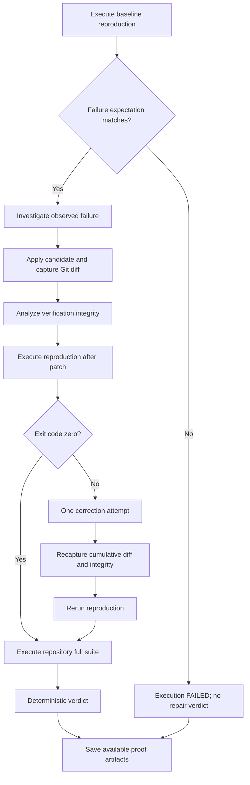

# Verification and proof evidence

PatchVerdict's verdict describes a candidate under recorded execution conditions. The engine separates a model's explanation from command observations, changes to the verification environment, and the final decision. A plausible diagnosis or a green test result is not sufficient on its own.

This guide explains the current rules and their limits. The [system design](SYSTEM_DESIGN.md) describes orchestration; [benchmark methodology](BENCHMARK_DASHBOARD.md) identifies the selected demonstrated runs.

## The verification path



Failures inside investigation, patching, or command infrastructure can interrupt this path. The runner preserves what it collected and returns execution `FAILED`; it does not invent results for stages that never completed.

## Baseline: establish the configured failure

[`createVerificationPlan()`](../src/verification/create-plan.ts) stores a reproduction command and its failure expectation separately from the repository's full-suite command. The general expectation type supports allowed exit codes, required output strings, and forbidden output strings.

The current [web/real-mission entry point](../src/real-mission-demo.ts) uses:

| Baseline condition | Current behavior |
| --- | --- |
| Command | Explicit reproduction command, or detected `npm test` / `pnpm test` when omitted |
| Exit code | Must be exactly `1` |
| Required output | Optional supplied failure marker, matched as a literal substring |
| Forbidden output | Literal `Startup Error` must be absent |

[`classifyReproduction()`](../src/verification/reproduction.ts) combines stdout and stderr, checks the exit code, and performs case-sensitive substring checks. All conditions must pass. A failure with another exit code, a missing required marker, or the forbidden marker does not establish reproduction under this plan.

The baseline is the reproduction command only. PatchVerdict does not separately run the full suite before the patch unless that is also the chosen reproduction command. When it is the default command, the same package test script is run at baseline, after patching, and again as the full-suite stage.

If classification fails, the mission stops before AI investigation with execution `FAILED` and no final repair verdict. Its available baseline output and classification can still be written to the proof bundle.

This is a concrete execution predicate, not semantic proof that the reported bug caused the failure. With no marker, an unrelated exit-1 failure can satisfy it. Even a marker may be insufficiently specific. Choose a stable command and a distinctive failure marker when the report has one; inspect the saved failure output before presenting a result.

## Investigation evidence and experiments

The investigation receives the trusted runner's baseline facts, including a bounded output excerpt. It can inspect files, search, and run a specific Vitest selector. Final structured output is validated against observed file reads, executed search queries, executed test selectors/commands, and the supplied baseline command.

The checks in [investigation-provenance.ts](../src/agent/investigation-provenance.ts) prevent unsupported source references: recommended targets must have been read and listed as relevant; relevant files require FILE observations; TEST and SEARCH sources must correspond to allowed observations. [investigation-targeting.ts](../src/agent/investigation-targeting.ts) checks the consistency of recommendations and explicit comparison of inspected test infrastructure when a direct test edit is proposed.

These validators check provenance and structure. They do not verify the truth of every natural-language observation, prove the root cause, or use the model's confidence as a verdict input. `LOW`, `MEDIUM`, and `HIGH` are model-reported confidence levels.

The prompt encourages targeted execution when it could distinguish competing hypotheses. The implemented experiment tool is [`run_test`](../src/tools/run-test.ts), which invokes `npx vitest run -t "<selector>"`; it does not offer a general intervention or counterfactual execution engine. The investigator has at most two new successful test tool results and can rely on the baseline without another test run. A successful tool result means evidence was returned, not that the test passed.

The advertised investigation tools omit editing, but the shared dispatcher is not explicitly restricted by phase in `investigate.ts`. Do not interpret the intended read-only investigation as an enforced security boundary; see [Security and limitations](SECURITY_AND_LIMITATIONS.md).

## Candidate application and correction

The patch agent uses the diagnosis to propose bounded text replacements in existing files. [`applyPatchTool()`](../src/tools/apply-patch.ts) requires the old text to occur exactly once, normalizes the replacement to the file's line endings, and reads the result back. An unchanged replacement does not satisfy patch application.

The runner then obtains `git rev-parse HEAD`, `git diff --no-ext-diff --no-color`, and `git diff --name-only` through [git-evidence.ts](../src/tools/git-evidence.ts). It records the actual diff and changed-file list, rejects an empty diff, and classifies verification integrity.

The reproduction command runs again. Post-patch success is **exit code zero**; the baseline failure-marker rules are not reused as a post-patch acceptance predicate. If this execution is nonzero, exactly one correction call receives the original diagnosis, existing candidate diff, and actual failing output. It must make a real change. The runner recaptures the cumulative diff, reevaluates integrity, and reruns reproduction.

There is no repeated repair-until-green loop. A failing full suite alone does not trigger correction. After a completed correction/reproduction path, the full suite still runs even if reproduction remains nonzero. Exceptions such as a no-op correction can end execution before that stage. [Patch recovery tests](../src/mission/patch-recovery.test.ts) cover these distinctions.

## Full-suite verification

The full-suite command is the package manager's invocation of the repository's existing `test` script: `npm test` or `pnpm test`. Exit code zero counts as passing. This name does not imply that the script exercises every test, includes type checks or linting, or measures coverage. Those properties depend on the target repository.

The [E2B wrapper](../src/sandbox/e2b.ts) captures each command as:

```text
command, exitCode, stdout, stderr, durationMs
```

An ordinary nonzero command result is returned as evidence rather than automatically treated as an infrastructure exception. A provider error without a numeric exit code propagates and may stop the mission. `durationMs` measures that wrapper's elapsed command execution, not total mission time.

## Integrity: passing tests under what conditions?

[`analyzeVerificationIntegrity()`](../src/verification/integrity.ts) examines changed paths and textual Git diff sections. Its three statuses are distinct from the final repair verdict:

| Integrity status | Meaning |
| --- | --- |
| `PRESERVED` | No implemented review flag or violation was detected. |
| `REVIEW_REQUIRED` | A recognized direct test or test-infrastructure file changed, with no detected violation. |
| `COMPROMISED` | At least one implemented violation was detected. |

Direct test paths are those under `__tests__` or ending in `.test.<extension>` / `.spec.<extension>`. Recognized infrastructure includes Vitest, Jest, Playwright, and Cypress configuration names; Vitest/Jest setup names; and `setupTests.<extension>`. Modifying these paths produces review flags even if tests pass.

The implemented violation checks detect:

- Added `.skip` / `.only` calls or `xdescribe`, `xit`, or `xtest` in recognized test files.
- Deletion of a recognized test file, or a recorded rename out of the recognized test-file pattern.
- Added discovery settings such as `include`, `exclude`, `testMatch`, `testRegex`, `testPathIgnorePatterns`, or `passWithNoTests` in recognized infrastructure.
- More removed active `expect(...)` assertion lines than added ones in a test diff section.
- A removed assertion using a listed specific matcher together with an added weak `toBeDefined`, `toBeTruthy`, or `toBeFalsy` matcher in that section.
- A changed `test` script line in the root `package.json` diff.

Violations take precedence over review flags. `preserved` is true only for `PRESERVED`; it is false for both review and compromise. `protectedChangedFiles` lists recognized direct test files, while infrastructure paths appear in review messages.

These are path and text heuristics, not an AST analysis or a complete detector of test weakening. For example, they do not recognize every test naming convention, assertion library, multiline assertion, indirect test-script dependency, or equivalent way to suppress a failure. Changes outside the known patterns can escape these checks. The available [integrity tests](../src/verification/integrity.test.ts) establish the listed cases, not exhaustive detection.

## Exact verdict rules

[`determineVerdict()`](../src/proof/verdict.ts) receives four functional booleans and an integrity status:

1. The baseline reproduced the configured failure.
2. A candidate patch was applied.
3. Reproduction passed after the candidate or its single correction.
4. The full suite passed after the patch.

Its precedence is:

| Condition | Repair verdict |
| --- | --- |
| Any functional check is false | `FAILED` |
| All functional checks pass, integrity is `COMPROMISED` | `FAILED` |
| All functional checks pass, integrity is `REVIEW_REQUIRED` | `REVIEW_REQUIRED` |
| All functional checks pass, integrity is `PRESERVED` | `VERIFIED` |

There is no model vote, confidence threshold, or human approval input in this function. [Verdict tests](../src/proof/verdict.test.ts) exercise the decision branches. The runner also guards against absent patches and empty Git diffs before reaching this calculation.

`VERIFIED` means the candidate satisfied this recorded plan without a detected integrity flag or violation. It does not guarantee correctness for other inputs, environments, commits, or tests. `REVIEW_REQUIRED` means functional checks passed but sensitive changes need human judgment; it is not an automatic approval. No UI action upgrades it to `VERIFIED`.

### Execution status is a separate dimension

| Saved execution | Saved verdict | Interpretation |
| --- | --- | --- |
| `COMPLETED` | `VERIFIED` | Calculation completed and accepted the recorded checks. |
| `COMPLETED` | `REVIEW_REQUIRED` | Calculation completed; passing checks still require review. |
| `COMPLETED` | `FAILED` | Calculation completed and rejected the candidate. |
| `FAILED` | `null` | Execution stopped before a final verdict; inspect available evidence/events. |
| No readable proof | Unavailable | The UI cannot establish a saved repair verdict. |

An early preparation failure, process crash, or timeout can leave only live failure status. A runner failure can leave a partial proof. Missing, invalid, or unsupported artifacts are availability problems, not newly calculated `FAILED` verdicts. Mission Control preserves the backend's saved result.

## Recorded example: tests pass, review remains

The selected Test State Leak mission is `web-d59e040c-e511-4d9e-bd6b-7cb6bfdd645d`, for `prahans/patchverdict-test-state-leak` at base commit `1fa2153bd4c940fa37ece47e4d3813e4daff5749`. Its local proof, patch, and three command artifacts were inspected on 2026-10-21; no new mission was executed for this documentation.

The recorded patch changes only `setupTests.js`:

```diff
-  return templateUser;
+  return { ...templateUser };
```

The baseline `npm test` exited 1, with two tests passing and `active adults are eligible` failing. Both subsequent `npm test` executions exited 0 with all three tests passing. The saved integrity status is `REVIEW_REQUIRED`, with no violations and the flag `Candidate modified test infrastructure: setupTests.js`. The final saved verdict is therefore `REVIEW_REQUIRED`.

The change addresses shared mutable test data, but it also changes the environment used to verify behavior. A reviewer needs to judge whether the new setup preserves the intended assertions and production rule. Passing tests cannot make that judgment automatically. See the [benchmark record](BENCHMARK_DASHBOARD.md) for the complete selected scenario list and evidence availability constraints. These local artifacts are not shipped automatically in a fresh clone.

## Proof bundle layout and preservation

The current [writer](../src/proof/bundle.ts) produces version 2 bundles:

```text
output/
  .runs/<missionId>.json          # Separate web live status, when applicable
  <missionId>/
    proof.json                    # Manifest, saved result, checks and metadata
    events.json                   # Timestamped runner events
    investigation.md              # Optional human-readable report
    patch.diff                    # Optional captured Git diff
    evidence/
      baseline-test.json          # Optional baseline command evidence
      post-patch-test.json        # Optional latest post-patch command evidence
      full-suite.json            # Optional full-suite command evidence
    pull-request.json             # Optional separate publication metadata
```

The manifest records mission input and source repository/base, optional GitHub issue metadata, reproduction and full-suite command labels, nested integrity findings, execution status, verdict, checks, reproduction classification, structured investigation, patch metadata, and artifact declarations. Fields for stages not completed can be null or absent. The current writer records errors through FAILED events; it does not serialize a separate top-level error field.

When a patch exists, `patch.sha256` hashes the exact UTF-8 bytes written to `patch.diff`, including its trailing newline. Publication uses that binding; old bundles without a digest remain viewable but are ineligible for new publication. A digest binds patch bytes to the manifest; it is not a signature authenticating the producer or every artifact.

The writer recreates its mission directory, writes supporting artifacts first, and publishes `proof.json` last through a temporary file and rename. Web submissions use unique IDs. Direct CLI IDs are derived from repository, base commit, and issue hash, so rerunning the same combination can replace that local directory. Preserve important evidence before rerunning or allowing retention to remove it.

The web [loader](../apps/web/lib/load-proof-bundle.ts) requires readable version 2 `proof.json` and `events.json`, validates their shapes and mission identity, and uses fixed supporting filenames with path containment checks. Missing optional artifacts remain unavailable without a warning; malformed or otherwise unreadable optional artifacts add warnings. Neither case creates replacement evidence. It reads saved fields and does not rerun verification or recalculate the verdict.

### What is not preserved or established

- The bundle stores the final diagnosis/report and inspected-file list, not the full model conversation or every tool response. Targeted investigation runs do not each receive a standalone command artifact.
- A correction replaces the saved `postPatchTest` evidence and candidate diff with the latest results. Events describe the correction path, but the initial candidate and its first failing post-patch output are not separate retained artifacts.
- Git evidence and integrity are captured before post-patch commands. There is no final Git snapshot after reproduction/full-suite execution to detect repository changes caused by those commands.
- The diff comes from ordinary tracked-file `git diff`; it is not a complete filesystem snapshot or an audit of untracked files and external state.
- Proof files are ordinary local files. They are not signed, append-only, or protected against a trusted host user editing them. The application assumes finalized evidence remains unchanged.
- Passing repository scripts do not establish hidden-test performance, security, compatibility across environments, or universal bug resolution. A human still needs to evaluate the report, patch, test relevance, and review flags.

The [proof writer tests](../src/proof/bundle.test.ts) cover exact patch hashing and final manifest publication. [Loader tests](../apps/web/tests/load-proof-bundle.test.mjs) cover required/optional artifact handling and preservation of recorded fields. These checks strengthen inspectability of a particular run; they do not extend the correctness claim beyond the evidence it actually contains.
